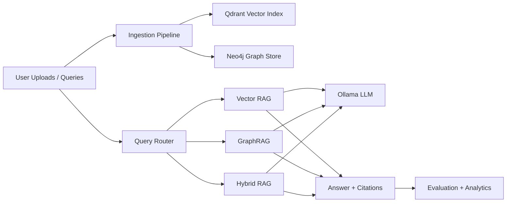

# RAG Benchmark Lab

An experimental platform for comparing Dense Vector RAG, GraphRAG, Hybrid RAG, and query routing over the same document corpus.

## Problem Statement

The project evaluates when graph-aware retrieval provides a meaningful advantage over dense vector retrieval, and whether a hybrid strategy can improve the quality-latency-cost tradeoff.

## Research Objectives

- Compare answer quality across retrieval strategies.
- Measure retrieval and generation latency separately.
- Preserve provenance for all retrieved evidence.
- Support reproducible evaluation runs.
- Provide an explainable routing mechanism.

## System Architecture



## Technology Stack

- Python 3.12
- Streamlit
- Qdrant
- Neo4j
- Sentence Transformers
- Ollama
- RAGAS compatibility layer for supported metrics
- SQLite for local metadata and evaluation persistence

## Installation

1. Create and activate a virtual environment.
2. Install the base application with `pip install -e .`.
3. Install the embedding stack when you want real Sentence Transformer embeddings with `pip install -e .[ml]`.
4. Copy `.env.example` to `.env` and adjust credentials if needed.
5. Start Qdrant and Neo4j with Docker Compose.
6. Start Ollama on the host and pull the configured model.

## Docker Setup

Run:

```bash
docker compose up -d qdrant neo4j
```

## Streamlit Startup

```bash
streamlit run app.py
```

## Sample Data

Sample synthetic documents live in `data/sample_documents/` and the sample evaluation dataset lives in `data/sample_evaluation/`.

## Notes

- Ollama is optional for initial testing because the project can run in mock generation mode.
- The base install uses mock embeddings when Sentence Transformers is not installed.
- Vector and graph backends are required for full ingestion and retrieval experiments.

## Limitations

- The sample corpus is synthetic and small.
- Graph extraction quality depends on the configured LLM.
- Full RAGAS metrics require compatible packages and may be unavailable in some environments.
